# Expense Voucher Management System

A full-stack web application that digitises ABC Company's expense-voucher process: **employees** create and submit vouchers, the **Director** approves or rejects them, and the **Accounts Team** monitors approved vouchers for reimbursement.

**Tech stack:** React 18 (Vite) · Node.js · Express · PostgreSQL · JWT · Multer

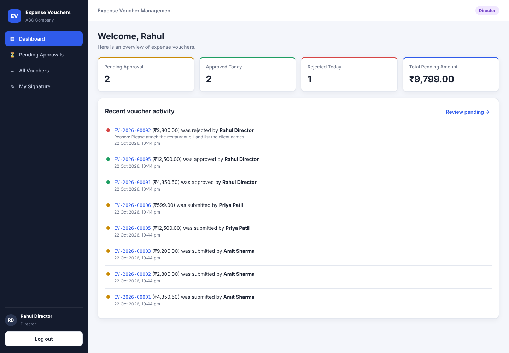

---

## Table of contents

1. [Features](#features)
2. [Project structure](#project-structure)
3. [Setup instructions](#setup-instructions)
4. [Demo accounts](#demo-accounts)
5. [Database schema](#database-schema)
6. [API documentation](#api-documentation)
7. [Business rules and how they are enforced](#business-rules-and-how-they-are-enforced)
8. [Assumptions](#assumptions)
9. [Testing](#testing)
10. [Deployment](#deployment)
11. [Screenshots](#screenshots)

---

## Features

| Area | What is implemented |
|---|---|
| **Authentication** | JWT login, bcrypt password hashing, session restore on refresh, auto-logout on expired token, login rate limiting |
| **Authorization** | Role checks on every API route (`EMPLOYEE`, `DIRECTOR`, `ACCOUNTS`) plus protected routes per role in React |
| **Employee** | Create voucher, save as Draft, edit/delete Draft, submit, upload signature (per voucher or a saved profile signature), view only own vouchers, track status, see rejection reason |
| **Director** | View all submitted vouchers, Pending Approvals screen, approve with signature (upload or saved), reject with mandatory reason, cannot edit employee data |
| **Accounts** | Read-only view of all submitted vouchers, view employee and director signatures, print / save voucher as PDF |
| **Search & filter (bonus)** | Free-text search plus filters on voucher number, employee name, department, category, status, date range and amount range. Sortable columns, pagination, and filters kept in the URL |
| **Dashboards** | Separate dashboard for each role with the counts and amounts from the spec |
| **Workflow** | `DRAFT → PENDING_APPROVAL → APPROVED / REJECTED`, with every step recorded in an audit timeline |
| **Validation** | Same rules on the client (instant feedback) and on the server (source of truth), plus database `CHECK` constraints |
| **File uploads** | PNG/JPG/WEBP only (checked by file content, not just extension), 2 MB limit. Images are stored in PostgreSQL, so the app works on hosts with temporary disks, and are served only to users allowed to see the voucher |
| **UI** | Responsive layout (sidebar collapses on mobile, tables become cards), toasts, modals, loading and empty states, print stylesheet |

---

## Project structure

```
expense-voucher-management/
├── backend/
│   ├── src/
│   │   ├── config/          # env + PostgreSQL pool
│   │   ├── controllers/     # HTTP layer (request -> service -> response)
│   │   ├── db/
│   │   │   ├── migrations/  # 001_initial_schema.sql
│   │   │   ├── migrate.js   # migration runner
│   │   │   └── seed.js      # demo users
│   │   ├── middleware/      # auth (JWT + roles), upload (multer), error handler
│   │   ├── routes/          # all REST routes in one place
│   │   ├── services/        # business logic + SQL (voucher, dashboard, auth, signature)
│   │   ├── utils/           # AppError, constants, helpers
│   │   ├── validators/      # input validation
│   │   ├── app.js           # express app
│   │   └── server.js        # entry point
│   ├── tests/api.test.js    # end-to-end API tests (node:test)
│   └── .env.example
├── frontend/
│   ├── src/
│   │   ├── api/             # fetch client + API functions
│   │   ├── components/      # Layout, ProtectedRoute, VoucherTable, Filters, SignatureInput, ...
│   │   ├── context/         # AuthContext, ToastContext
│   │   ├── pages/           # Login, Dashboard, VoucherForm, VoucherList, VoucherDetails, Profile
│   │   ├── utils/           # formatting helpers
│   │   ├── App.jsx          # routes
│   │   └── styles.css
│   └── .env.example
├── docs/
│   ├── screenshots/
│   └── sample-signatures/   # sample PNGs you can upload while testing
├── docker-compose.yml       # optional PostgreSQL container
├── render.yaml              # one-click Render deployment (web service + database)
└── package.json             # root build/start scripts used for deployment
```

---

## Setup instructions

### Prerequisites

- **Node.js 18+** and npm
- **PostgreSQL 13+**, either installed locally or started with Docker (`docker compose up -d`)

### 1. Clone

```bash
git clone https://github.com/MOHIT247ij/expense-voucher-management.git
cd expense-voucher-management
```

### 2. Database

Make sure PostgreSQL is running. `npm run db:setup` (next step) **creates the `expense_voucher` database automatically** if it does not exist, so you only need the `postgres` user's password. If you prefer Docker, `docker compose up -d` starts PostgreSQL with user `postgres` and password `postgres`.

### 3. Backend

```bash
cd backend
cp .env.example .env        # Windows: copy .env.example .env
# edit .env -> set DB_PASSWORD (and a long random JWT_SECRET)
npm install
npm run db:setup            # runs migrations + seeds demo users
npm run dev                 # API on http://localhost:5000/api
```

### 4. Frontend

Open a second terminal:

```bash
cd frontend
cp .env.example .env        # Windows: copy .env.example .env
npm install
npm run dev                 # app on http://localhost:5173
```

Open **http://localhost:5173** and log in with one of the demo accounts below. In development, Vite proxies `/api` to `http://localhost:5000`, so CORS needs no extra setup.

### Environment variables

**backend/.env**

| Variable | Default | Description |
|---|---|---|
| `PORT` | `5000` | API port |
| `CLIENT_URL` | `http://localhost:5173` | Allowed CORS origin(s), comma separated |
| `APP_TIMEZONE` | `Asia/Kolkata` | Timezone used for "Approved Today" / "Rejected Today" |
| `DB_HOST` / `DB_PORT` / `DB_NAME` / `DB_USER` / `DB_PASSWORD` | local Postgres | Connection settings |
| `DATABASE_URL` | – | Optional full connection string (overrides the above) |
| `DB_SSL` | `false` | Set `true` for hosted Postgres (Neon, Render, …) |
| `JWT_SECRET` | – (**required**) | Secret used to sign tokens |
| `JWT_EXPIRES_IN` | `8h` | Token lifetime |
| `MAX_FILE_SIZE_MB` | `2` | Upload size limit |

**frontend/.env**

| Variable | Default | Description |
|---|---|---|
| `VITE_API_URL` | `/api` | API base URL (use the full URL when the backend is deployed separately) |

---

## Demo accounts

All demo users share the password **`Password@123`**. The login page also has one-click buttons that fill these in.

| Role | Email | Name |
|---|---|---|
| Director | `director@abc.com` | Rahul Director |
| Accounts | `accounts@abc.com` | Anita Accounts |
| Employee | `amit@abc.com` | Amit Sharma (Sales) |
| Employee | `priya@abc.com` | Priya Patil (IT) |

Sample signature images to upload are in [`docs/sample-signatures`](docs/sample-signatures).

---

## Database schema

The schema is in [`backend/src/db/migrations/001_initial_schema.sql`](backend/src/db/migrations/001_initial_schema.sql) and is applied by `npm run migrate`.

```
┌──────────────────────┐        ┌───────────────────────────────┐        ┌──────────────────────┐
│ users                │        │ vouchers                      │        │ voucher_activity     │
├──────────────────────┤        ├───────────────────────────────┤        ├──────────────────────┤
│ id (PK)              │◄───┐   │ id (PK)                       │◄───────│ voucher_id (FK)      │
│ name                 │    ├───│ employee_id (FK users)        │        │ id (PK)              │
│ email (unique)       │    └───│ reviewed_by (FK users)        │        │ action               │
│ password_hash        │        │ voucher_number (unique, auto) │        │ actor_id (FK users)  │
│ role (enum)          │        │ voucher_date, expense_date    │        │ remarks              │
│ employee_code        │        │ department, expense_title     │        │ created_at           │
│ department           │        │ expense_category, description │        └──────────────────────┘
│ signature_id (FK) ───┼──┐     │ amount NUMERIC(12,2) > 0      │
│ is_active            │  │     │ employee_name, employee_code  │        ┌──────────────────────┐
│ created_at/updated_at│  │     │ employee_signature_id (FK) ───┼───┐    │ signatures           │
└──────────────────────┘  │     │ status (enum)                 │   │    ├──────────────────────┤
                          │     │ submitted_at                  │   ├───►│ id (PK)              │
                          │     │ director_signature_id (FK) ───┼───┤    │ mime_type            │
                          │     │ approval_date                 │   │    │ size_bytes           │
                          │     │ rejection_reason, rejected_at │   │    │ data (BYTEA)         │
                          │     │ created_at, updated_at        │   │    │ uploaded_by          │
                          │     └───────────────────────────────┘   │    │ created_at           │
                          └─────────────────────────────────────────┘    └──────────────────────┘
```

### Tables

**`users`** holds every login. `role` is a PostgreSQL enum (`EMPLOYEE`, `DIRECTOR`, `ACCOUNTS`). `signature_id` points to an optional *saved* signature that is reused when an employee submits or the Director approves.

**`vouchers`** holds one row per expense voucher, grouped as in the spec:

- *Basic info:* `voucher_number`, `voucher_date`, `expense_date`, `department`, `expense_title`, `expense_category`, `expense_description`, `amount`
- *Employee info:* `employee_id`, `employee_name`, `employee_code` (a snapshot taken at creation), `employee_signature_id`
- *Approval info:* `status`, `reviewed_by`, `director_signature_id`, `approval_date`, `rejection_reason`, `rejected_at`, `submitted_at`
- *Audit info:* `created_at`, `updated_at` (kept current by a trigger)

**`signatures`** stores the uploaded images (`BYTEA`). Rows are never updated: replacing a signature inserts a new row, so a signed voucher always keeps the exact image it was signed with. Unused rows are cleaned up when a draft is deleted or its signature replaced.

**`voucher_activity`** is an append-only audit log (`CREATED`, `UPDATED`, `SUBMITTED`, `APPROVED`, `REJECTED`). It powers the voucher timeline and the Director's "Recent Voucher Activity".

**`schema_migrations`** records which migration files have already been applied.

### Key design decisions

- **Voucher number generation.** The column default is `'EV-' || YYYY || '-' || LPAD(nextval('voucher_number_seq'), 5, '0')`, which gives numbers like `EV-2026-00001`. A sequence is used so numbers stay unique even when two vouchers are created at the same moment, and the `UNIQUE` constraint guarantees it.
- **Business rules are also enforced in the database.** These `CHECK` constraints back up the service layer:
  - `amount > 0`
  - any non-draft voucher must have an employee signature
  - an approved voucher must have a director signature and an approval date
  - a rejected voucher must have a non-empty reason
- **Signatures live in the database, and rows are immutable.** This makes the app work on hosts with a temporary filesystem (Render, Railway, …). It also means a voucher can safely point to the same row as the user's saved signature: replacing the saved signature creates a new row and never changes a voucher that was already signed.
- **Indexes** cover the columns used for filtering: employee, status, department, category and expense date.
- **Amounts** use `NUMERIC(12,2)` to avoid floating-point rounding errors.

---

## API documentation

Base URL: `http://localhost:5000/api`. All endpoints except `/auth/login` and `/health` require the header `Authorization: Bearer <token>`.

Response format:

```jsonc
// success
{ "success": true, "data": { ... }, "message": "optional" }
// error
{ "success": false, "message": "Validation failed", "errors": { "amount": "Amount must be greater than zero" } }
```

Status codes used: `200`, `201`, `400` (validation), `401` (not logged in / bad token), `403` (wrong role), `404` (not found, or not visible to you), `409` (action not allowed in the voucher's current status), `500`.

### Auth

| Method | Endpoint | Role | Description |
|---|---|---|---|
| POST | `/auth/login` | public | Body `{ email, password }`, returns `{ token, user }`. Rate limited to 20 attempts per 15 minutes |
| GET | `/auth/me` | any | Current user (used to restore the session) |
| POST | `/users/me/signature` | Employee, Director | `multipart/form-data`, field **`signature`**. Saves or replaces the profile signature |
| GET | `/users/me/signature` | any | Returns the saved signature image |

### Vouchers

| Method | Endpoint | Role | Description |
|---|---|---|---|
| GET | `/vouchers` | any | List vouchers visible to the caller (see query parameters below) |
| GET | `/vouchers/:id` | any | Voucher details plus `activity` timeline |
| POST | `/vouchers` | Employee | Create a voucher, **always saved as `DRAFT`**. JSON or `multipart/form-data` (optional file field **`employeeSignature`**) |
| PUT | `/vouchers/:id` | Employee (owner) | Update a **Draft** (same body as create) |
| DELETE | `/vouchers/:id` | Employee (owner) | Delete a **Draft** |
| POST | `/vouchers/:id/submit` | Employee (owner) | `DRAFT → PENDING_APPROVAL`. Needs a voucher signature or a saved profile signature |
| POST | `/vouchers/:id/approve` | Director | `PENDING_APPROVAL → APPROVED`. `multipart/form-data` with **`directorSignature`**, or no body if the Director has a saved signature |
| POST | `/vouchers/:id/reject` | Director | `PENDING_APPROVAL → REJECTED`. Body `{ "reason": "..." }` (required, 5 to 1000 characters) |
| GET | `/vouchers/:id/signatures/:type` | any (with access to the voucher) | `type` = `employee` or `director`. Returns the image |

**Create / update body**

```json
{
  "department": "Sales",
  "expenseTitle": "Client visit - Mumbai",
  "expenseCategory": "Travel",
  "expenseDescription": "Train tickets and local cab",
  "expenseDate": "2026-10-15",
  "amount": 4350.50
}
```

Allowed `department` and `expenseCategory` values come from `GET /meta`.

**`GET /vouchers` query parameters**

| Param | Example | Notes |
|---|---|---|
| `search` | `mumbai` | Matches voucher number, employee name or title |
| `voucherNumber` | `EV-2026-0001` | Partial match |
| `employeeName` | `amit` | Partial, case-insensitive |
| `department` | `Sales` | Exact |
| `category` | `Travel` | Exact |
| `status` | `PENDING_APPROVAL` or `APPROVED,REJECTED` | One status or a comma-separated list |
| `fromDate` / `toDate` | `2026-10-01` | Range on expense date (`YYYY-MM-DD`) |
| `minAmount` / `maxAmount` | `1000` | Amount range |
| `sortBy` | `voucherNumber`, `voucherDate`, `expenseDate`, `employeeName`, `department`, `category`, `amount`, `status`, `createdAt`, `updatedAt` | Whitelisted (no SQL injection). Default `createdAt` |
| `sortOrder` | `asc` / `desc` | Default `desc` |
| `page` / `limit` | `1` / `10` | `limit` is capped at 100 |

Response: `{ success, data: Voucher[], pagination: { page, limit, total, totalPages }, summary: { totalAmount } }`

**Voucher object**

```json
{
  "id": 1,
  "voucherNumber": "EV-2026-00001",
  "voucherDate": "2026-10-22",
  "expenseDate": "2026-10-15",
  "department": "Sales",
  "expenseTitle": "Client visit - Mumbai",
  "expenseCategory": "Travel",
  "expenseDescription": "Train tickets and local cab",
  "amount": 4350.5,
  "employeeId": 3,
  "employeeName": "Amit Sharma",
  "employeeCode": "EMP001",
  "hasEmployeeSignature": true,
  "status": "APPROVED",
  "submittedAt": "2026-10-22T16:53:10.000Z",
  "reviewedBy": 1,
  "reviewedByName": "Rahul Director",
  "hasDirectorSignature": true,
  "approvalDate": "2026-10-22T16:55:02.000Z",
  "rejectionReason": null,
  "rejectedAt": null,
  "createdAt": "2026-10-22T16:52:40.000Z",
  "updatedAt": "2026-10-22T16:55:02.000Z"
}
```

Image data is not embedded in the JSON. The client gets `hasEmployeeSignature` / `hasDirectorSignature` flags and loads images through the protected signature endpoint.

### Dashboard and lookups

| Method | Endpoint | Role | Returns |
|---|---|---|---|
| GET | `/dashboard` | any | Role-specific data (below) |
| GET | `/meta` | any | `{ departments, categories, statuses }` |
| GET | `/health` | public | `{ status: "ok" }` |

- **Employee:** `totalVouchers`, `draftVouchers`, `pendingApproval`, `approvedVouchers`, `rejectedVouchers`, `totalAmountClaimed`, `totalAmountApproved`, plus `recentVouchers`
- **Director:** `pendingApprovalCount`, `approvedToday`, `rejectedToday`, `totalPendingAmount`, plus `recentActivity`
- **Accounts:** `totalVouchers`, `pendingApproval`, `approvedVouchers`, `rejectedVouchers`, `totalApprovedAmount`, plus `recentApprovedVouchers`

### Quick example with curl

```bash
TOKEN=$(curl -s -X POST localhost:5000/api/auth/login -H "Content-Type: application/json" \
  -d '{"email":"amit@abc.com","password":"Password@123"}' | node -pe "JSON.parse(require('fs').readFileSync(0)).data.token")

curl -X POST localhost:5000/api/vouchers -H "Authorization: Bearer $TOKEN" \
  -F department=Sales -F expenseTitle="Cab to client" -F expenseCategory=Travel \
  -F expenseDate=2026-10-20 -F amount=450 -F employeeSignature=@docs/sample-signatures/amit.png
```

---

## Business rules and how they are enforced

| # | Rule | Where |
|---|---|---|
| 1–2 | Unique, auto-generated voucher number | DB sequence default + `UNIQUE` |
| 3 | New vouchers start as Draft | `INSERT … status 'DRAFT'` (the client cannot choose a status) |
| 4–5 | Edit/delete only while Draft; read-only after submission | Service row lock (`SELECT … FOR UPDATE`) + status check → `409` |
| 6 | Only the Director approves/rejects | `authorize('DIRECTOR')` route guard |
| 7 | Approved is read-only | Status checks: no endpoint changes an approved voucher |
| 8 | Rejection needs a reason | Validator + DB `CHECK` |
| 9 | Employees only see their own vouchers | Every query is filtered by `employee_id`; others get `404` |
| 10–11 | Director and Accounts see every (submitted) voucher | Visibility rule in the service |
| 12 | Submitted voucher has an employee signature | Service check + DB `CHECK` |
| 13 | Approved voucher has a director signature | Service check + DB `CHECK` |

Approve and reject run in a transaction with a row lock, so two parallel requests cannot both process the same voucher.

---

## Assumptions

1. **No self-registration.** Users are created by the seed script (in a real deployment, by an admin or HR system). The spec only asks for login.
2. **Status names.** The spec shows *Draft → Submitted → Pending Approval*. Submitting moves a voucher straight to `PENDING_APPROVAL` (stored with `submitted_at`). "Submitted" is the action, and "Pending Approval" is the resulting state.
3. **Drafts are private.** The Director and Accounts "view every voucher" means every voucher that has been submitted. An employee's unfinished drafts are not shown to them (requests return `404`).
4. **Rejected is final.** The spec says employees cannot modify rejected vouchers, so to claim again the employee creates a new voucher. A "revise and resubmit" flow would be a small extension.
5. **Signature handling.** An employee can upload a signature on each voucher, or save one on the *My Signature* page. If a voucher has none at submission, the saved one is copied onto it. The Director works the same way when approving.
6. **One Director.** Any user with the `DIRECTOR` role can approve. Multi-level approval and amount limits were out of scope.
7. **Departments and categories** are fixed lists (`backend/src/utils/constants.js`), served to the UI through `/meta`, and validated on the server.
8. **Expense date** cannot be in the future. Amount must be greater than 0, at most ₹1,00,00,000, with up to 2 decimal places.
9. **Voucher date** is the creation date, set by the server.
10. **"Today"** on the Director dashboard uses `APP_TIMEZONE` (default `Asia/Kolkata`).
11. **Download/print** for Accounts uses the browser's *Print → Save as PDF* with a dedicated print stylesheet, so no extra PDF library is needed.
12. **Signature images are stored in PostgreSQL.** They are small (≤ 2 MB), and this keeps deployment to a single service plus a database. For large attachments such as bill scans, object storage (S3) would be the better choice.

---

## Testing

The backend has an end-to-end API suite (Node's built-in test runner, no extra dependencies) with **21 tests**. They cover authentication, every role restriction, all validation and business rules, the full workflow, signature access control, search/filter/sort/pagination, and the dashboards.

The suite **truncates voucher data**, so run it against a separate database:

```bash
createdb -U postgres expense_voucher_test

# macOS / Linux
cd backend
DB_NAME=expense_voucher_test npm run db:setup
DB_NAME=expense_voucher_test npm test

# Windows PowerShell
cd backend
$env:DB_NAME="expense_voucher_test"; npm run db:setup; npm test
```

```
ok 1 - login rejects wrong password and missing fields
ok 2 - protected routes require a valid token
...
ok 21 - employee can delete own draft
# pass 21
# fail 0
```

---

## Deployment

The app deploys as **one web service** (Express serves both the API and the built React app) plus a **PostgreSQL database**. The root `package.json` provides:

- `npm run build`: installs both apps and builds the frontend into `frontend/dist`
- `npm start`: runs migrations, seeds the demo users (safe to repeat), and starts the server

### Render (free tier, using the included `render.yaml`)

1. Push this repository to GitHub.
2. On [render.com](https://render.com), go to **New → Blueprint**, select the repository, then click **Apply**.
3. Render creates the PostgreSQL database and the web service, generates `JWT_SECRET`, and connects `DATABASE_URL` automatically.
4. When the build finishes, open `https://<service-name>.onrender.com` and log in with a demo account.

> On the free plan the service sleeps after about 15 minutes of inactivity, so the first request after that can take up to a minute.

### Vercel (frontend + API as a serverless function) with a Neon PostgreSQL database

`vercel.json` builds the React app, runs migrations and seed during the build, and serves the Express API from `api/index.js` as a serverless function.

1. Import the GitHub repository in Vercel (**Add New → Project**). Keep the defaults, because `vercel.json` already defines the commands.
2. Go to **Storage → Create Database → Neon (Postgres)** and connect it to the project. This adds `DATABASE_URL`.
3. Under **Settings → Environment Variables**, add:
   - `JWT_SECRET`: any long random string
   - `DB_SSL`: `true`
   - `NODE_ENV`: `production`
4. **Redeploy**. The app runs at `https://<project>.vercel.app`.

### Any other Node host (Railway, a VPS, …)

Set `NODE_ENV=production`, `DATABASE_URL` (plus `DB_SSL=true` if your provider needs it) and `JWT_SECRET`, then run:

```bash
npm run build
npm start
```

---

## Screenshots

| | |
|---|---|
| **Login** 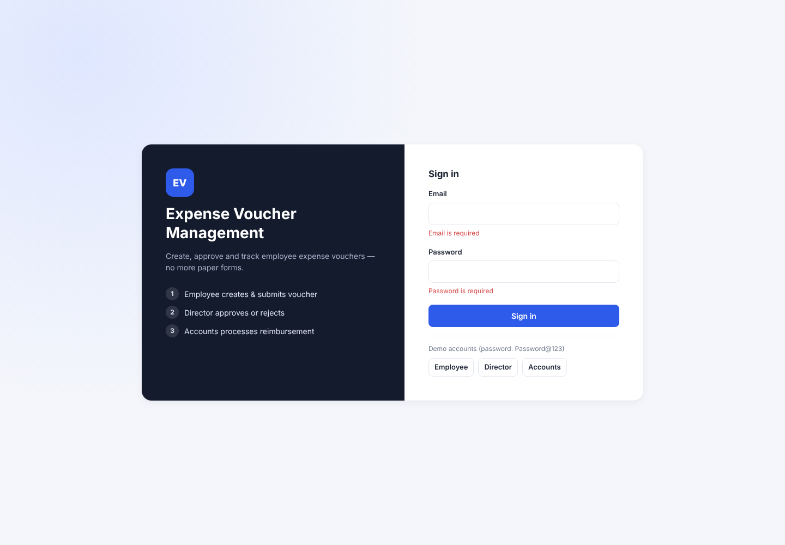 | **Employee dashboard** 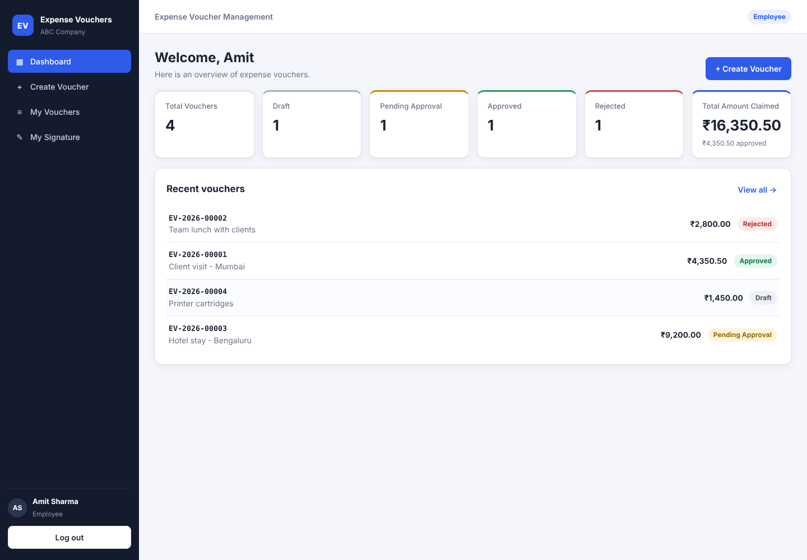 |
| **Create voucher** 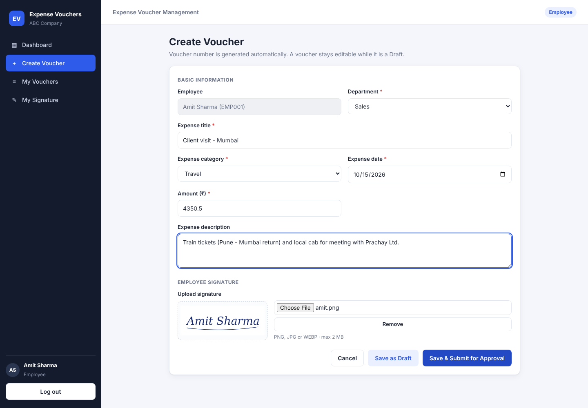 | **Validation** 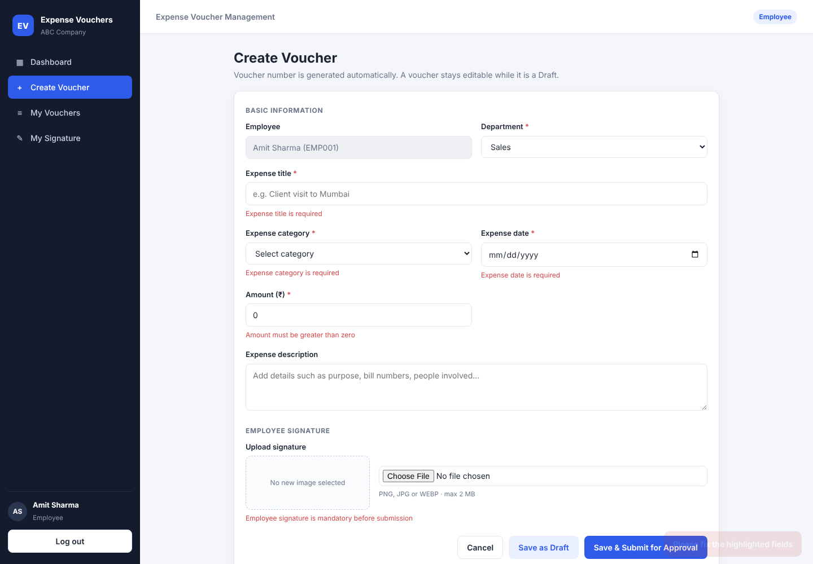 |
| **My vouchers** 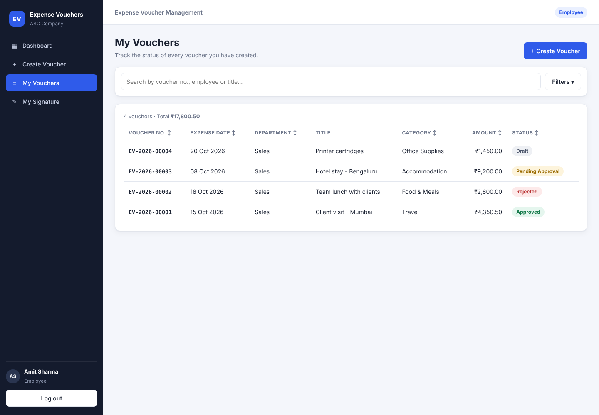 | **Rejected voucher (employee view)** 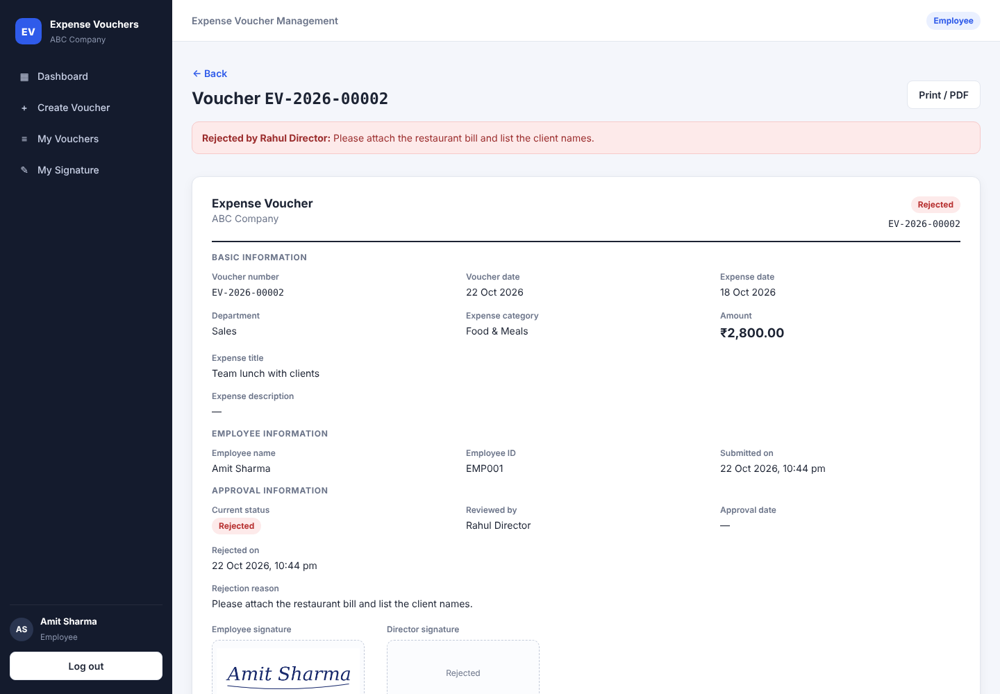 |
| **Director: pending approvals** 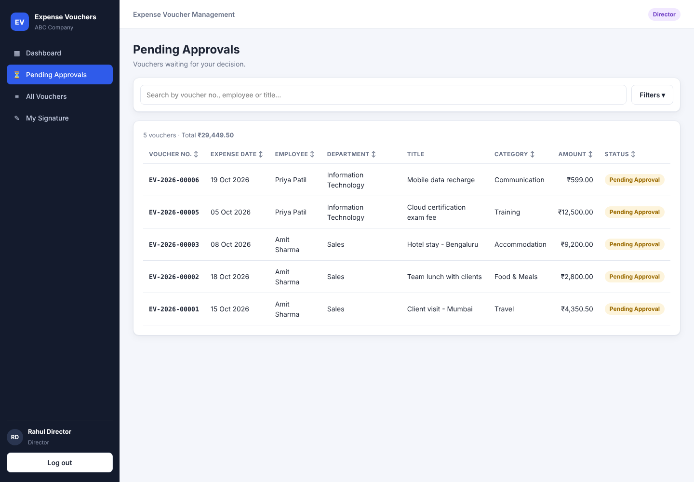 | **Director: approve with signature** 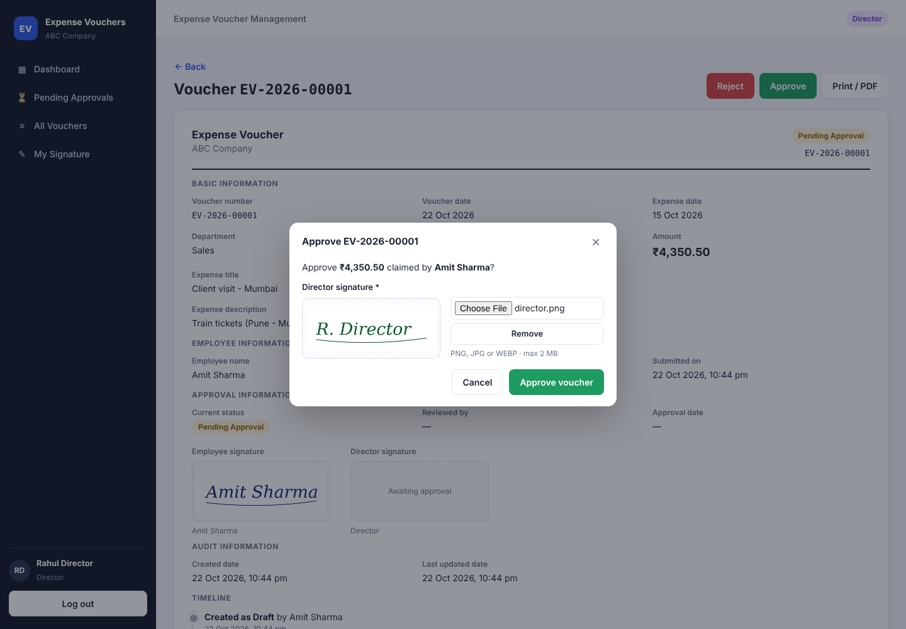 |
| **Director: reject with reason** 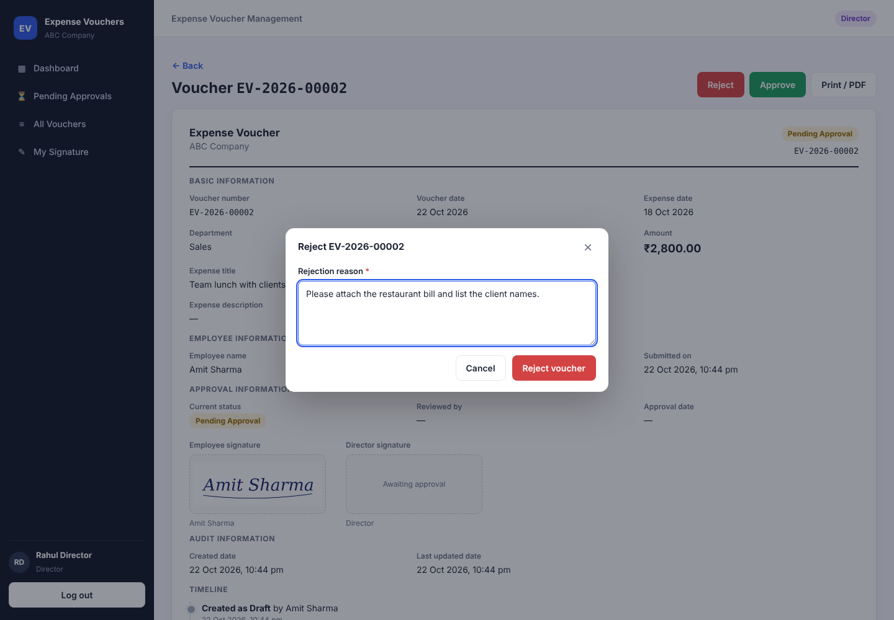 | **Accounts dashboard** 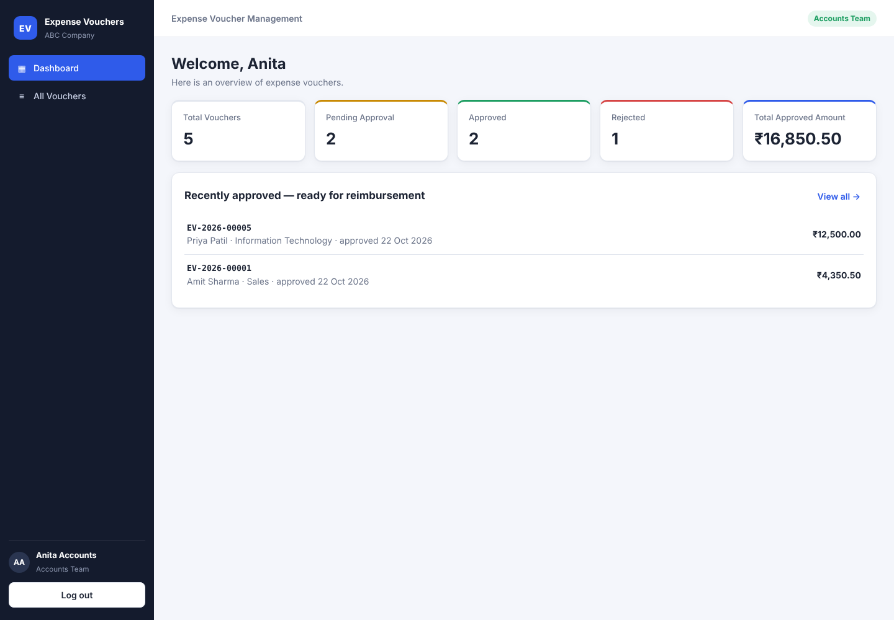 |
| **Accounts: search, filter & sort** 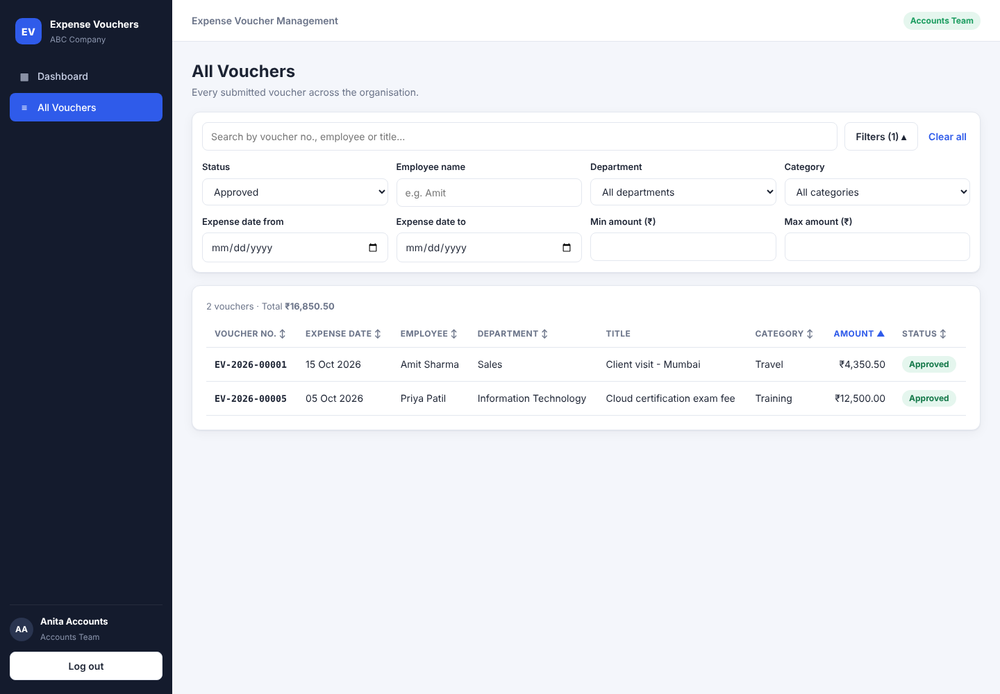 | **Approved voucher with both signatures** 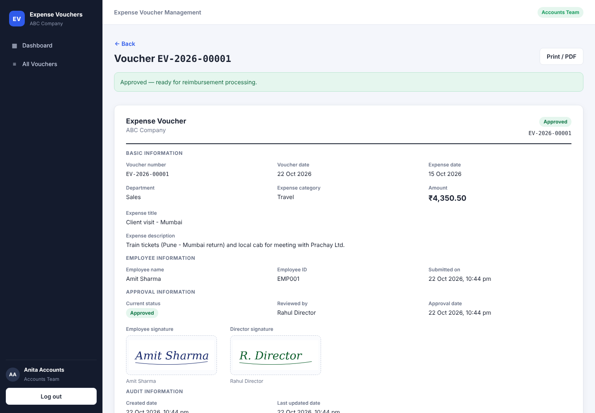 |
| **Print / PDF view** 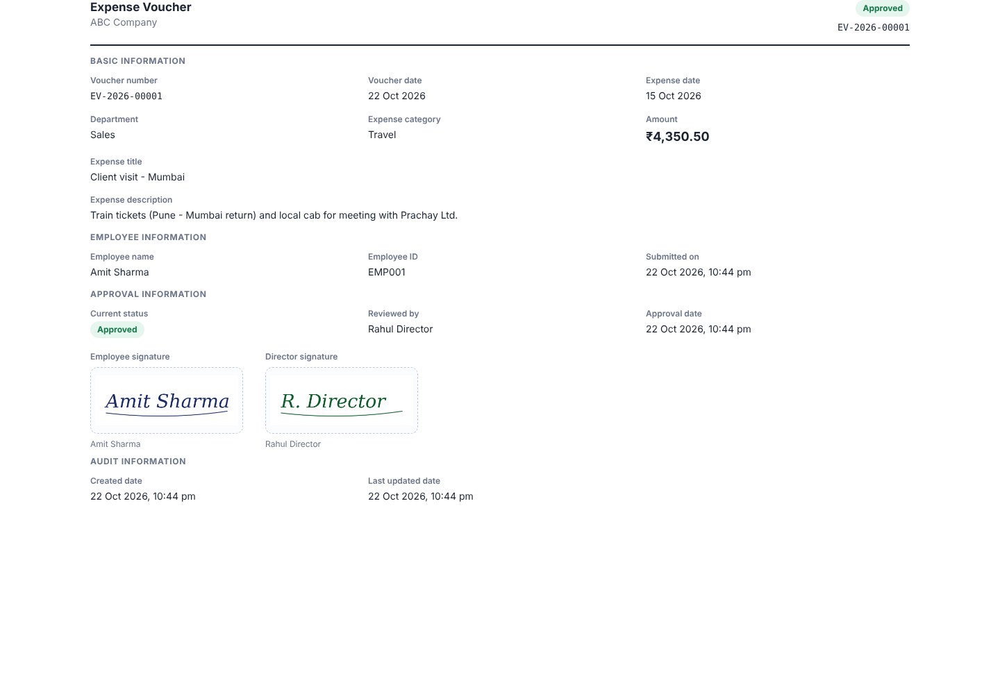 | **Mobile** 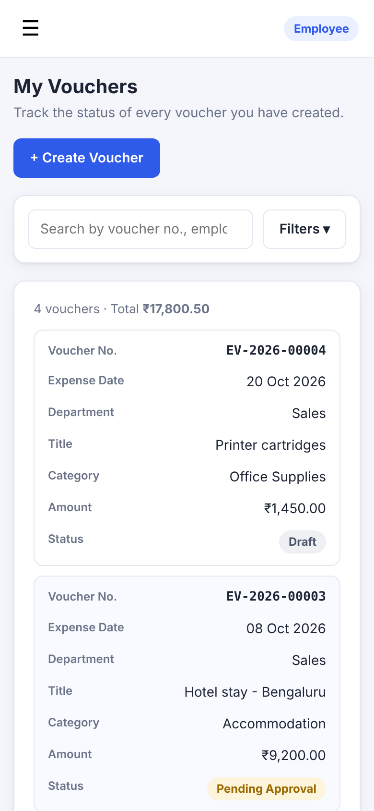 |

---

## Possible improvements

- Bill/receipt attachments on each voucher, and a "Mark as Paid" step for Accounts
- Revise-and-resubmit flow for rejected vouchers
- Email notifications on submit, approve and reject
- Refresh tokens stored in httpOnly cookies
- Admin screen for managing users, departments and categories

---

**Author:** Mohit Hingase · [GitHub](https://github.com/MOHIT247ij) · [LinkedIn](https://www.linkedin.com/in/mohit-hingase-318a88249)
